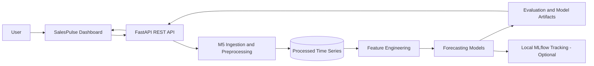
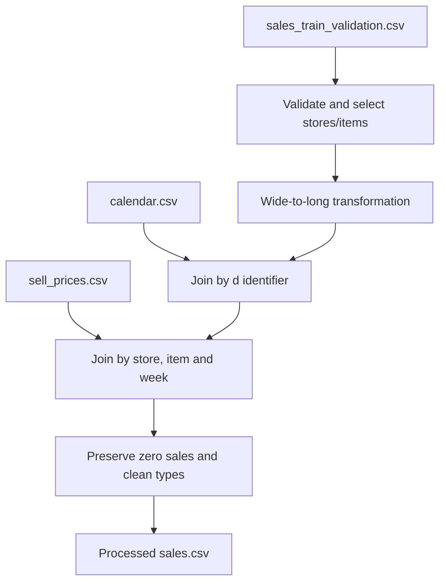
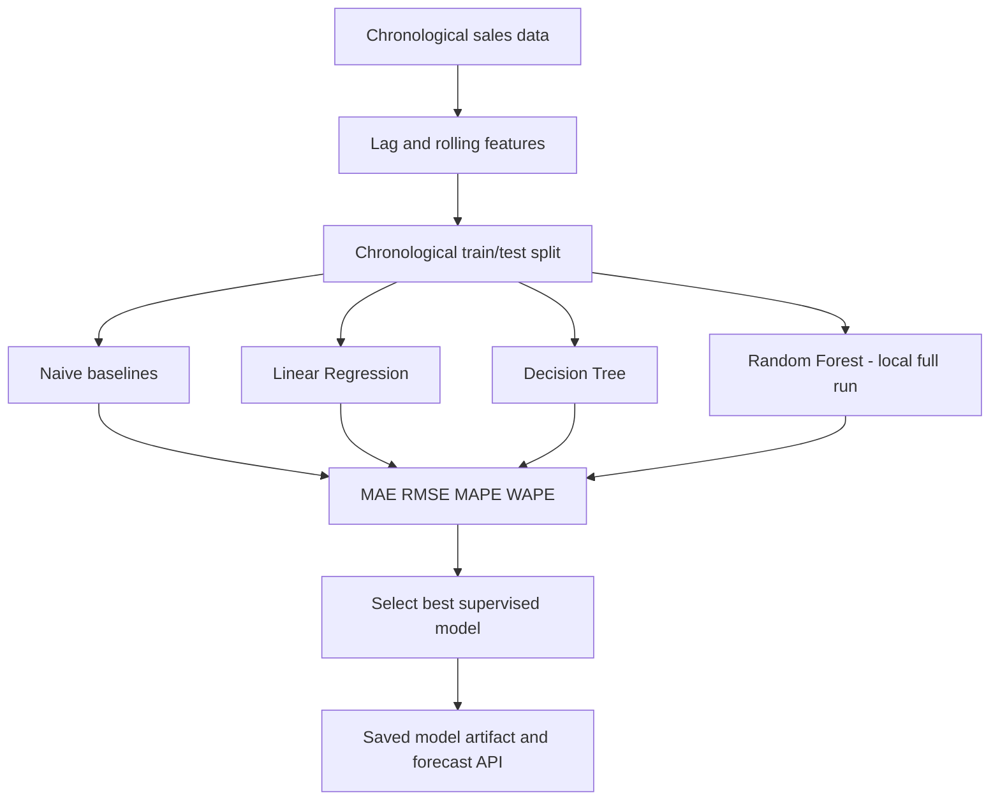
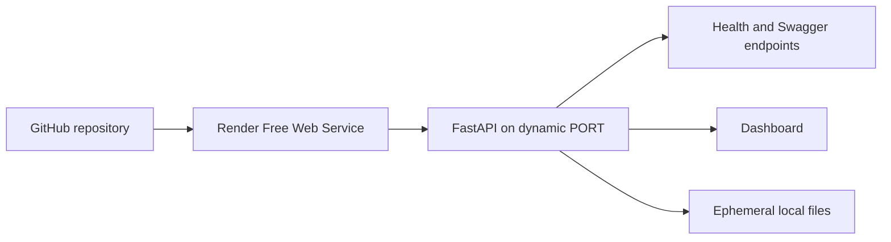

# System architecture

## Data processing flow

## Model pipeline

## Deployment architecture

The Render free service uses ephemeral storage; uploaded data and models may need to be reloaded after restart or sleep.
